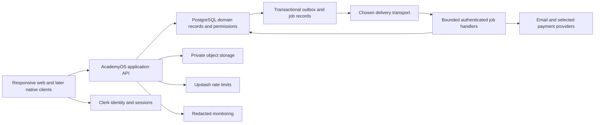

# Architecture and platform approach

Status: selected stack direction with proposed implementation boundaries. Exact package versions are resolved, compatibility-tested and locked at foundation kickoff. Requirements: AO-131–160.

## System shape

Build a modular monolith: one web deployment and one authoritative database, with modules for identity/tenancy, people, scheduling, attendance, family finance, trainer compensation, platform commerce, evaluation, media, notifications, support, inventory and reporting. Each module owns its operations and table access. Avoid microservices until independent scale or security boundaries justify them.

Next.js/React/TypeScript provides the responsive web client and server routes on Vercel. PostgreSQL on Supabase is the business authority. Clerk provides identity/session management through its supported native Supabase integration. Supabase Storage holds private objects. Upstash is the selected initial rate-limit service. PostgreSQL outbox/job records preserve work; QStash is the proposed HTTP delivery transport. Sentry and uptime checks provide operational signals, not business truth.

## Request boundary

The server verifies identity, resolves the current membership and evaluates capability/resource/entitlement rules. It validates input through shared schemas and calls a domain operation. Critical transitions execute transactionally in PostgreSQL, producing result, operation receipt, audit event and outbox intent together. The API returns a typed outcome with correlation ID. UI state updates from the committed outcome.

Use end-user JWT context for RLS-protected data access where practical. Browser direct access is limited to explicitly reviewed reads or constrained upload flows. Do not expose general write access to financial, role, approval or job tables. Server use of a privileged key is not a substitute for authorization: isolate privileged adapters, validate actor and tenant before invocation, and constrain database execution grants. A background worker uses a service identity and a persisted authorized job scope, never a user ID supplied blindly in the request body.

## Module boundaries

Shared code may contain IDs, validation, money/date utilities, capabilities, error types and design tokens. It must not make all modules depend on another module's internal tables. Cross-domain effects use explicit operations/events: roster enrollment requests billing; approved attendance correction requests recalculation; published evaluation requests notification; confirmed platform payment updates entitlement.

The three money domains have separate table families, transaction types, reports and capabilities. Reuse arithmetic/idempotency primitives, not a generic ambiguous “payments” table carrying every business meaning.

## Environment and deployment boundaries

Local and automated tests use disposable synthetic data. Preview uses nonproduction identity, storage, email sink and payment sandbox. Staging is a stable protected environment with production-like configuration and synthetic acceptance accounts. Production has separate secrets, data, issuer and endpoints. Provider-native environment inheritance must be reviewed rather than trusted.

Place application execution near the database after D-019 resolves region and residency. Measure actual p95 latency before choosing additional regions. Cross-region deployment can increase database round trips; a globally cached static page does not make writes globally local. Never publicly cache personalized responses or private media.

## Evolution to other platforms

First complete responsive web and a bounded PWA experience. Then use Expo/React Native for iOS/Android if approved, sharing schemas, API contracts, domain types and semantic design tokens. Share business rules on the server; do not duplicate financial or permission logic in each client. Native screens use platform navigation, secure storage and push facilities.

Desktop packaging with Tauri is an optional later decision, not a requirement to finish before web launch. macOS/Windows distribution introduces signing, updates, OS permissions and device-specific testing. A wrapper cannot automatically turn web offline storage into a reliable native queue.

Version APIs and support a declared client compatibility window. Server migrations must tolerate older supported mobile clients. Include capability negotiation and minimum-version messaging, while preserving pending offline operations during upgrades. See [future services](../05-services/13-optional-services-and-future-platforms.md).

## Engineering quality constraints

Every module needs reproducible migrations, seed fixtures, positive/negative authorization tests, typed contracts, observable operation IDs and documented recovery. No real academy data in development. No production credentials needed to run ordinary tests. No dashboard-only schema edits without a corresponding reviewed migration. Hosted database policy/function definitions must be compared with the migration baseline before release.
