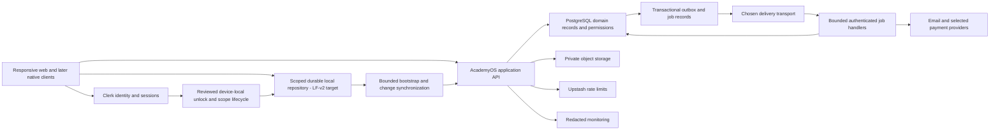

# Architecture and platform approach

## Version2 architecture mapping —7November2026

[Canonical master plan v2](../06-delivery/master-plan-v2/README.md). The new master package records current source versus proposed full-product gaps, typed sport/resource extensions, tenant boundaries and the existing local/sync/PWA architecture. It does not authorize a rewrite, new schema or competing offline engine. Keep specific canonical operations, field projections and protected original contracts.

## Current local-data foundation and installed delivery — 6 November 2026

The [EX-13 continuity receipt](../07-handoff/ex13b-workspace-continuity-2026-11-05.md) and [EX-11 register evidence](../07-handoff/owner-register-window-and-hosted-checkpoint-2026-11-04.md) supersede historical inactive descriptions for their declared implemented/deployed subsets. Current EX-07 integrates the ordinary Attendance task; broader domains remain partial.

The [PWA contract](../06-delivery/pwa-delivery-and-readiness.md) adds installation/launch/update and actual installed evidence to this same architecture. Reuse the existing protected repositories, scopes, sync coordinator and original sender; no native rewrite, second database/cache/queue or competing root worker. Installed/browser containers may have separate auth/storage/key state. Preserve exact public-code/private-data and domain authority boundaries, same-account recovery and compatible worker/code/schema updates. This documentation checkpoint installs no library or new PWA code.

## Persistent local data and synchronization — LF-v2,2November2026

The new current target is a scoped durable local repository plus transactional coverage/indexes and a separate sync coordinator, detailed in [local-data and sync plan](../06-delivery/local-data-and-sync-plan.md). Compare IndexedDB adapters for web/PWA; a query library alone cannot implement disk persistence or replication. Preserve current signed APIs/Clerk/current DB authority. No schema/SDK/store is installed here; v1 memory-only recommendations are superseded.

## Earlier working-day data lifecycle — superseded proposal context,2November2026

The [working-behaviour contract](../03-design/academy-working-behavior-contract.md), [execution guide](../06-delivery/experience-execution.md) and [tracker](../06-delivery/experience-execution.csv) now make shared ownership/pilot architecture an explicit EX-10 gate before dependent adoption. EX-11 is connected operating acceptance. No framework, cache store, queue, provider or infrastructure replacement is selected by this documentation.

The architecture packet must locate six different owners in actual source: identity/session; scoped persistent workspace/navigation; compatible domain read coordination; unfinished task state; original-operation reconciliation/discovery; authoritative server/data boundary. The read owner defines scoped keys, subscription lifetime, in-flight coordination, hydration/seed handoff, invalidation and accepted memory reuse. Draft fields and pending writes must not be stored inside a reusable server-result cache. Account/academy/capability/link changes invalidate incompatible work and late replies. A layout/sidebar identity label never authorizes a private read or action.

Compare minimal server delivery with coordinated client reads where it removes actual waterfalls; do not move every query into a root layout or add duplicate client hydration fetches. Existing signed/current-authority operations remain canonical. Prepare likely destinations only under explicit row/byte/concurrency/waste budgets; retain existing paging/totals and avoid whole-app preloading. A focused query library versus existing primitives is an engineering choice requiring measured fit, compatibility, security and bundle/runtime/cost review. Private display age, retention, persistence and offline behaviour are dependent policy choices, not library defaults. See WB-P01–WB-P04; no values are accepted here.

Status: selected stack direction with proposed implementation boundaries. Exact package versions are resolved, compatibility-tested and locked at foundation kickoff. Requirements: AO-131–160.

## System shape

Build a modular monolith: one web deployment and one authoritative database, with modules for identity/tenancy, people, scheduling, attendance, family finance, trainer compensation, platform commerce, evaluation, media, notifications, support, inventory and reporting. Each module owns its operations and table access. Avoid microservices until independent scale or security boundaries justify them.

Next.js/React/TypeScript provides the responsive web client and server routes on Vercel. PostgreSQL on Supabase is the business authority. Clerk provides identity/session management through its supported native Supabase integration. Supabase Storage holds private objects. Upstash is the selected initial rate-limit service. PostgreSQL outbox/job records preserve work; QStash is the proposed HTTP delivery transport. Sentry and uptime checks provide operational signals, not business truth.

## Request boundary

The server verifies identity, resolves the current membership and evaluates capability/resource/entitlement rules. It validates input through shared schemas and calls a domain operation. Critical transitions execute transactionally in PostgreSQL, producing result, operation receipt, audit event and outbox intent together. The API returns a typed outcome with correlation ID. UI state updates from the committed outcome.

Use end-user JWT context for RLS-protected data access where practical. Browser direct access is limited to explicitly reviewed reads or constrained upload flows. Do not expose general write access to financial, role, approval or job tables. Server use of a privileged key is not a substitute for authorization: isolate privileged adapters, validate actor and tenant before invocation, and constrain database execution grants. A background worker uses a service identity and a persisted authorized job scope, never a user ID supplied blindly in the request body.

## Module boundaries

Shared code may contain IDs, validation, money/date utilities, capabilities, error types and design tokens. It must not make all modules depend on another module's internal tables. Cross-domain effects use explicit operations/events: roster enrollment requests billing; approved attendance correction requests recalculation; published evaluation requests notification; confirmed platform payment updates entitlement.

The three money domains have separate table families, transaction types, reports and capabilities. Reuse arithmetic/idempotency primitives, not a generic ambiguous “payments” table carrying every business meaning.

## Environment and deployment boundaries

Local and automated tests use disposable synthetic data. Preview uses nonproduction identity, storage, email sink and payment sandbox. Staging is a stable protected environment with production-like configuration and synthetic acceptance accounts. Production has separate secrets, data, issuer and endpoints. Provider-native environment inheritance must be reviewed rather than trusted.

Place application execution near the database after D-019 resolves region and residency. Measure actual p95 latency before choosing additional regions. Cross-region deployment can increase database round trips; a globally cached static page does not make writes globally local. Never publicly cache personalized responses or private media.

## Evolution to other platforms

First complete responsive web and a bounded PWA experience. Then use Expo/React Native for iOS/Android if approved, sharing schemas, API contracts, domain types and semantic design tokens. Share business rules on the server; do not duplicate financial or permission logic in each client. Native screens use platform navigation, secure storage and push facilities.

Desktop packaging with Tauri is an optional later decision, not a requirement to finish before web launch. macOS/Windows distribution introduces signing, updates, OS permissions and device-specific testing. A wrapper cannot automatically turn web offline storage into a reliable native queue.

Version APIs and support a declared client compatibility window. Server migrations must tolerate older supported mobile clients. Include capability negotiation and minimum-version messaging, while preserving pending offline operations during upgrades. See [future services](../05-services/13-optional-services-and-future-platforms.md).

## Engineering quality constraints

Every module needs reproducible migrations, seed fixtures, positive/negative authorization tests, typed contracts, observable operation IDs and documented recovery. No real academy data in development. No production credentials needed to run ordinary tests. No dashboard-only schema edits without a corresponding reviewed migration. Hosted database policy/function definitions must be compared with the migration baseline before release.

## Data delivery and performance contracts

Apply the [experience/performance plan](../03-design/experience-performance-and-data-loading.md) and [screen/data matrix](../03-design/screen-data-loading-matrix.csv) before module implementation. Use bounded authorized projections, avoid serial waterfalls and per-row query fan-out, and inspect representative database work. Cache rules distinguish action authority, operational reads, derived summaries, reference data and provider observations. Shared Redis business caching and realtime subscriptions need measured justification and reviewed scope; current provider configuration is not implementation proof.
